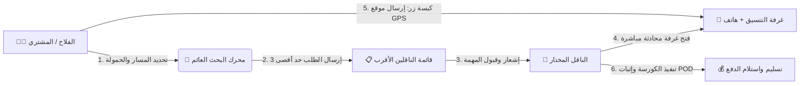
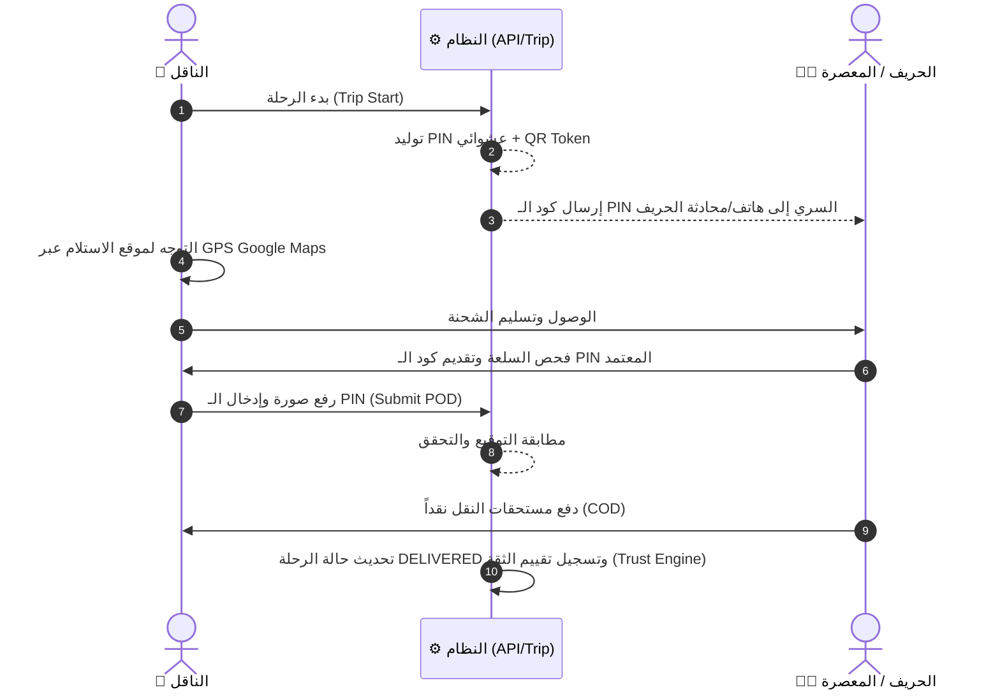
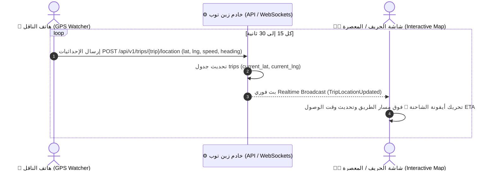

# 🚚 الدليل الشامل لهندسة ونظام النقل الفلاحي في منصة زين توب
# Comprehensive Agricultural Transportation Architecture & Workflow Guide (ZinToop)

---

## 📌 الفهرس العام (Table of Contents)
1. [مقدمة وأهداف منظومة النقل في المنصة](#1-مقدمة-وأهداف-منظومة-النقل-في-المنصة)
2. [هيكلية قاعدة البيانات والنماذج (Database & Models)](#2-هيكلية-قاعدة-البيانات-والنماذج-database--models)
3. [دورة تسجيل وتأهيل الناقلين (Carrier Onboarding & Profile)](#3-دورة-تسجيل-وتأهيل-الناقلين-carrier-onboarding--profile)
4. [محرك التسعير وتصنيف أسطول النقل (Pricing Engine & Vehicle Tiers)](#4-محرك-التسعير-وتصنيف-أسطول-النقل-pricing-engine--vehicle-tiers)
5. [واجهة المستخدم والزر العائم الذكي (Marketplace UI & Smart Floating Button)](#5-واجهة-المستخدم-والزر-العائم-الذكي-marketplace-ui--smart-floating-button)
6. [آلية إرسال الطلبات وحماية الكوتا (Request Dispatch & Anti-Spam Quota)](#6-آلية-إرسال-الطلبات-وحماية-الكوتا-request-dispatch--anti-spam-quota)
7. [قبول المهمة، المحادثة الفورية وتحديد الموقع الدقيق (Acceptance, Chat & GPS Drop)](#7-قبول-المهمة-المحادثة-الفورية-وتحديد-الموقع-الدقيق-acceptance-chat--gps-drop)
8. [تنفيذ الرحلة، إثبات التسليم والدفع المالي (Trip Execution, POD & Payment Flow)](#8-تنفيذ-الرحلة-إثبات-التسليم-والدفع-المالي-trip-execution-pod--payment-flow)
9. [نموذج استدامة المنصة: معلوم 1 دينار رمزي عن كل رحلة مؤكدة (Platform 1 TND Future Fee)](#9-نموذج-استدامة-المنصة-معلوم-1-دينار-رمزي-عن-كل-رحلة-مؤكدة-platform-1-tnd-future-fee)
10. [نظام التتبع الحي لموقع ومسار الشاحنة (Live GPS Truck Tracking)](#10-نظام-التتبع-الحي-لموقع-ومسار-الشاحنة-live-gps-truck-tracking)
11. [خريطة المسارات البرمجية ونقاط النهاية (API & Web Routes Reference)](#11-خريطة-المسارات-البرمجية-ونقاط-النهاية-api--web-routes-reference)

---

## 1. مقدمة وأهداف منظومة النقل في المنصة

يُعدّ نقل الزيتون وزيت الزيتون والمعدات الفلاحية حلقة الوصل الأكثر حساسية في سلاسل التوريد التونسية. صُممت منظومة النقل في **ZinToop** لتحقيق الأهداف التالية:
- **إلغاء الوسطاء التجاريين (Zero Brokerage Fees):** ربط مباشر بين الفلاح/المعصرة والناقل بدون اقتطاع نسب مئوية تجارية مرهقة، مع اعتماد **معلوم رمزي مستقبلي قدره 1 دينار تونسي فقط** عن كل رحلة مؤكدة لدعم استمرارية وتطوير خوادم المنصة.
- **تغطية شاملة لجميع وسائل النقل:** من السيارات النفعية الصغيرة (Partner / Caddy) والشاحنات الخفيفة (D-Max / Sprinter) إلى الشاحنات المتوسطة، الثقيلة والصهاريج الغذائية المعقمة (Inox).
- **التسعير العادل والشفاف:** خوارزمية تسعير تحسب المسافة الحقيقية وتكاليف المحروقات والخدمة حسب المعايير المعمول بها في السوق التونسي بالدينار (TND).
- **تتبع مسار الشاحنة الحي (Live GPS Tracking):** تمكين الحريف والمعصرة من مشاهدة الشاحنة وهي تتحرك على الخريطة لحظة بلحظة حتى وصول الشحنة.
- **تجربة مستخدم فائقة السلاسة:** نموذج بحث عائم ذكي، تقسيم دقيق للولايات والمعتمديات، وتوجيه فوري بالـ GPS عبر خرائط جوجل لتفادي ضياع السائق.

---

## 2. هيكلية قاعدة البيانات والنماذج (Database & Models)

### أ. جدول طلبات النقل الفورية (`transporter_requests`)
تمت إضافة هذا الجدول لضبط وتتبع طلبات النقل المباشرة من الصفحة الرئيسية وسجل الحالات:

| الحقل (Field) | النوع (Type) | الوصف |
| :--- | :--- | :--- |
| `id` | `BIGINT UNSIGNED` | المعرف الأساسي |
| `user_id` | `BIGINT UNSIGNED` | معرف صاحب الطلب (طالب الخدمة) |
| `carrier_id` | `BIGINT UNSIGNED` | معرف الناقل المستهدف |
| `weight` | `DECIMAL(10,2)` | وزن الحمولة المطلوب نقلها |
| `unit` | `VARCHAR(10)` | الوحدة (`ton`، `kg`، `l`) |
| `pickup_governorate` | `VARCHAR(100)` | ولاية الانطلاق (مثال: صفاقس) |
| `pickup_delegation` | `VARCHAR(100)` | معتمدية الانطلاق (مثال: عقارب) *(مضافة حديثاً)* |
| `pickup_lat` / `lng` | `DECIMAL(10,7)` | الإحداثيات الجغرافية للانطلاق |
| `dropoff_governorate` | `VARCHAR(100)` | ولاية الوصول (مثال: تونس) |
| `dropoff_delegation` | `VARCHAR(100)` | معتمدية الوصول (مثال: المرسى) *(مضافة حديثاً)* |
| `dropoff_lat` / `lng` | `DECIMAL(10,7)` | الإحداثيات الجغرافية للوصول |
| `distance_km` | `DECIMAL(10,2)` | المسافة الطرقية التقديرية بالكم |
| `estimated_cost` | `DECIMAL(10,2)` | السعر التقديري العادل بالدينار التونسي |
| `status` | `ENUM` | `pending` (قيد الانتظار)، `accepted` (مقبول)، `declined` (مرفوض)، `cancelled` (ملغى) |
| `accepted_at` | `TIMESTAMP` | توقيت قبول الناقل للمهمة |
| `expires_at` | `TIMESTAMP` | انتهاء صلاحية الطلب (مضبوط بـ 10 دقائق) |

### ب. جدول ملف الناقل (`carriers` / `users`)
- الدور: `role = 'carrier'` في جدول `users`.
- حقول إضافية في ملف الناقل:
  * `camion_capacity`: طاقة استيعاب الشاحنة بالطن.
  * `preferred_govs`: الولايات المفضلة للعمل.
  * `vehicle_type`: نوع العربة (فورغونات، شاحنة خفيفة، ثقيلة، صهريج).
  * `verified_at`: تأكيد وتوثيق هوية الناقل من طرف الإدارة.
  * `rating`: تقييم الناقل التراكمي (1 إلى 5 نجوم).

### ج. جدول الرحلات وإثبات التسليم (`trips` & `pods`)
- `trips`: يحتوي على كود التتبع التسلسلي `sr_code` (مثال: `TRP-XXXX`)، رمز التحقق الرقمي المشفر `pin_hash`، وتوكن الاستجابة السريعة `pin_qr`.
- `pods`: وثيقة إثبات التسليم (Proof Of Delivery) تتضمن صور التحميل، صور التفريغ، توقيع المستلم، ومطابقة كود الـ PIN أو مسح الـ QR Code.

---

## 3. دورة تسجيل وتأهيل الناقلين (Carrier Onboarding & Profile)

1. **رابط التسجيل المخصص:** `GET /register?role=carrier` عبر الواجهة [`register_carrier.blade.php`](file:///Users/zinehamdi/Sites/localhost/tuni-olive-hub/register_carrier.blade.php).
2. **البيانات المطلوبة إجبارياً:**
   - الاسم الكامل والصفة المهنية.
   - البريد الإلكتروني.
   - رقم الهاتف التونسي الفعال (بصيغة `+216 XX XXX XXX`) لتسهيل الاتصال المباشر بالحرفاء.
   - كلمة المرور وتأكيدها.
   - **سعة الشاحنة (بالطن):** حقل `camion_capacity` الذي يعتمد عليه محرك البحث لمطابقة وزن الحمولة المطلوبة مع طاقة الناقل.
3. **البيانات الاختيارية والتوثيق:**
   - صورة الملف الشخصي وصور الشاحنة.
   - فحص الإدارة لمنح شارة "ناقل موثق" (Verified Transporter) لزيادة الموثوقية لدى الفلاحين.

---

## 4. محرك التسعير وتصنيف أسطول النقل (Pricing Engine & Vehicle Tiers)

تم بناء الخدمة المركزية في [`app/Services/TransportPricingService.php`](file:///Users/zinehamdi/Sites/localhost/tuni-olive-hub/app/Services/TransportPricingService.php):

### أ. فئات أسطول النقل المعتمدة في السوق التونسي (Vehicle Tiers)
| الفئة البرمجية | التسمية الدارجة والنوع | الحمولة القصوى | معلوم الانطلاق القار (Base Fee) | السعر لكل 1 كم (Rate/KM) |
| :--- | :--- | :--- | :--- | :--- |
| `fourgonnette` | 🚐 **فورغونات** (Peugeot Partner, VW Caddy) | حتى 1000 كغ (1 طن) | **25.00 د.ت** | **0.750 د.ت / كم** |
| `light_commercial` | 🛻 **شاحنة خفيفة** (Isuzu D-Max, Mercedes Sprinter, Stafette) | من 1 إلى 2.5 طن | **40.00 د.ت** | **1.000 د.ت / كم** |
| `light_truck` | 🚛 **شاحنة متوسطة** (إيسيزو / ميتسوبيشي كانتر) | من 2.5 إلى 5 طن | **70.00 د.ت** | **1.500 د.ت / كم** |
| `heavy_truck` | 🚚 **شاحنة ثقيلة** (شاحنات نقل الزيتون الكبيرة) | من 5 إلى 12 طن | **120.00 د.ت** | **2.000 د.ت / كم** |
| `tanker` | 🛢️ **صهريج غذائي Inox** (معقم لنقل زيت الزيتون الصب) | تفوق 12 طن (حتى 30 طن) | **220.00 د.ت** *(يشمل الغسيل والتعقيم)* | **2.800 د.ت / كم** |

### ب. خوارزمية احتساب المسافة الجغرافية الحقيقية (Haversine with Road Factor)
لا تسير الشاحنات في خطوط مستقيمة جوية، لذلك تطبق الخوارزمية معادلة هافرسين مع معامل تضاريس وطرقات تونسية $1.25\times$:
$$\text{Distance (KM)} = \text{Haversine}(\text{Lat}_1, \text{Lng}_1, \text{Lat}_2, \text{Lng}_2) \times 1.25$$
- إذا لم تتوفر إحداثيات GPS مفصلة، تعتمد المنظومة على إحداثيات مراكز الـ 24 ولاية تونسية المخزنة داخلياً (`GOVERNORATES`).

### ج. معادلة التكلفة التقديرية العادلة:
$$\text{Total Cost (TND)} = \text{Base Fee} + (\text{Distance (KM)} \times \text{Rate per KM})$$
- يُعرض للحريف أيضاً نطاق تفاوضي عادل يتراوح بين $-8\%$ و $+8\%$ لترك مرونة في الاتفاق الودي بين الطرفين.

---

## 5. واجهة المستخدم والزر العائم الذكي (Marketplace UI & Smart Floating Button)

تم تصميم تجربة طلب الناقل في الواجهة الرئيسية [`resources/views/home_marketplace.blade.php`](file:///Users/zinehamdi/Sites/localhost/tuni-olive-hub/resources/views/home_marketplace.blade.php) بمواصفات عصرية فائقة:

### أ. الزر العائم الذكي (Smart FAB):
- **الموقع:** أعلى يسار الشاشة بصيغة ثابتة (`fixed top-32 left-3 sm:top-36 sm:left-6 z-40`).
- **الحجم:** تصميم كبسولي مصغر (Mini-Pill) لا يحجب القوائم أو البنرات.
- **التفاعل مع التمرير (Scroll Translucency):**
  * عند وقوف المستخدم في أعلى الصفحة: يظهر بوضوح تام (`opacity-95`).
  * عند التمرير للأسفل وتصفح العروض (`window.scrollY > 40`): يتحول تلقائياً إلى شبه شفاف (`opacity-40`) مع ضبابية خلفية ناعمة (`backdrop-blur-md`) حتى لا يعيق قراءة بطاقات المنتجات.
  * بمجرد تحريك الفأرة فوقه أو لمسه على الهاتف (`hover` / `focus`): يعود فوراً إلى كامل وضوحه (`opacity-100`).
- **حالات الزر الثلاث (State Reactivity):**
  1. **الوضع العادي الخامل (Idle State):** زر كحلي هادئ: `🚚 طلب ناقل ➔`.
  2. **وضع الانتظار النشط (Waiting State):** زر برتقالي مع نقطة تنبيه وامضة: `⏳ بانتظار ناقل... (1/3)`.
  3. **وضع قبول المهمة (Accepted State):** زر زمردي براق نابض: `🎉 وافق الناقل: [الاسم] - فتح المحادثة 💬`.

### ب. نافذة طلب الناقل - الخطوة الأولى (Step 1 Modal):
- **مسار الانطلاق:** سطر واحد مقسم لنصفين متجاورين (`grid grid-cols-2 gap-2`):
  * حقل اختيار الولاية (24 ولاية تونسية).
  * حقل المعتمدية التابعة للولاية المختارة، يتحدث ديناميكياً من قاموس المعتمديات الشامل (`tunisianDelegations`).
- **مسار الوصول:** سطر واحد مقسم أيضاً (`ولاية الوصول` + `معتمدية الوصول`).
- **حمولة الشحنة:** حقل عددي مع أزرار سريعة جاهزة بنقرة واحدة:
  * `500 كغ` (فورغونات)
  * `1 طن` (فورغونات/ستافات)
  * `2 طن` (شاحنة خفيفة)
  * `5 طن` (شاحنة متوسطة)
  * `10 طن` (شاحنة ثقيلة)
  * `25 طن` (صهريج / شاحنة ضخمة)
- شارة تلقائية توضح نوع وسيلة النقل المناسبة لوزن الشحنة لحظياً.
- زر الـ GPS لتحديد موقع الانطلاق بدقة جهاز المستخدم.
- عرض فوري للمسافة المتوقعة بالكم والسعر التقديري بالدينار.

---

## 6. آلية إرسال الطلبات وحماية الكوتا (Request Dispatch & Anti-Spam Quota)

في الخطوة الثانية من النموذج:
1. **فرز وترتيب الناقلين:** يسترجع النظام الناقلين المسجلين ويرتبهم تصاعدياً حسب قربهم من ولاية الانطلاق.
2. **قاعدة الكوتا المشددة (Anti-Spam 3-Request Limit):**
   * يُسمح للحريف بإرسال **3 طلبات كحد أقصى في نافذة زمنية مدتها 10 دقائق**.
   * عند إرسال طلب، تظهر علامة `⏳ قيد الانتظار` مع كود إرسال فوري للناقل.
3. **إمكانية الإلغاء الفوري (Cancel Option):**
   * بجانب كل ناقل تم إرسال طلب له، يوجد زر `❌ إلغاء الطلب`.
   * عند النقر على إلغاء، يتم إلغاء الطلب في الخادم فوراً (`status = 'cancelled'`)، مما يحرر خانة في الكوتا فوراً، ليتمكن الحريف من طلب ناقل آخر دون الحاجة للانتظار 10 دقائق كاملة.
4. **المزامنة والتحديث المستمر (Background Polling):**
   * يعمل مؤقت خفيف في الخلفية كل 4 ثوانٍ لفحص ما إذا وافق أي ناقل على الطلب.

---

## 7. قبول المهمة، المحادثة الفورية وتحديد الموقع الدقيق (Acceptance, Chat & GPS Drop)

عندما يفتح الناقل حسابه ويرى الطلب ويضغط على **"قبول المهمة"**:
1. **إغلاق التنافس:** يتم تحويل حالة طلبه إلى `accepted` وإلغاء أوتوماتيكي لجميع الطلبات المعلقة الأخرى التابعة لنفس الرحلة.
2. **إنشاء غرفة المحادثة:** يستدعي النظام فئة `Chat::ensureThread` لفتح قناة تواصل مباشرة بين الحريف والناقل.
3. **إرسال رسالة نظام رسمية مؤطرة:** تتضمن تفاصيل الرحلة، الوزن، المسار، السعر، ورقم هاتف الحريف مع إشعار للناقل بالاتصال به.
4. **بطاقة المهمة الذكية في المحادثة (`transporter_request_accepted`):**
   - **عند الناقل:** يظهر زر اتصال مباشر بنقرة واحدة: `📞 الاتصال بالحريف (tel:XXXXXXXX)`.
   - **عند الحريف:** يظهر زر سحري بارز: `📍 إرسال موقعي الدقيق للناقل`.
5. **مشاركة إحداثيات خرائط جوجل بنقرة واحدة:**
   * عند ضغط الحريف على زر الموقع، يستخرج المتصفح إحداثيات الـ GPS الفائقة الدقة (`navigator.geolocation`).
   * يتم توليد رابط خرائط جوجل تلقائي:
     `https://www.google.com/maps?q=36.806500,10.181500`
   * يرسله النظام كرسالة، فيكفي أن ينقر السائق على الرابط لتفتح خرائط جوجل مباشرة وتبدأ الملاحة خطوة بخطوة إلى مكان وجود الزيتون أو الزيت.

---

## 8. تنفيذ الرحلة، إثبات التسليم والدفع المالي (Trip Execution, POD & Payment Flow)

### أ. الأمان بواسطة كود التحقق (Trip Secret PIN & QR):
- عند انطلاق الشاحنة، يُنشئ النظام كود سري من 4 إلى 6 أرقام مع رمز QR مشفر.
- يتم إشعار صاحب الحمولة بالكود السري.
- لا يستطيع الناقل إنهاء الرحلة إلا بعد إدخال الكود الصحيح الذي يسلمه إياه المستلم عند المعاينة، أو مسح رمز الاستجابة السريعة، مع رفع صور واضحة للشحنة كإثبات تسليم رسمي (POD).

### ب. طرق الدفع المالي المعتمدة (Payment Rules):
1. **الدفع المباشر عند التسليم (Cash On Delivery - COD):**
   - الطريقة الأكثر شيوعاً وعملية في القطاع الفلاحي التونسي.
   - يدفع الحريف أجرة النقل نقداً يد بيد للناقل فور وصول الشحنة والتأكد من سلامتها.
2. **الربط مع طلبات المنصة المدمجة (`Order`):**
   - إذا كانت الرحلة مرتبطة بطلبية شراء زيت زيتون مدرجة مسبقاً بنظام الدفع عند الاستلام، فإن اكتمال الرحلة (`Trip complete`) يغير حالة دفع الطلبية تلقائياً إلى `PAY_COLLECTED`، مع تسجيل نقاط ثقة إضافية للطرفين عبر محرك الموثوقية (`TrustEngine`).
3. **الربط المخزني التلقائي مع المعاصر (`Mill Storage Integration`):**
   - في حال كان مكان الوصول معصرة مسجلة وكانت الحمولة حبات زيتون (`olive`)، يسجل النظام أوتوماتيكياً حركة دخول مخزني (`in: olive`)، ومحاكاة استخلاص الزيت الصافي بنسبة الاستخراج الوطنية القياسية (22%)، مع تحديث حسابات التمويل الفلاحي المشترك (`Financing`).

---

## 9. نموذج استدامة المنصة: معلوم 1 دينار رمزي عن كل رحلة مؤكدة (Platform 1 TND Future Fee)

### أ. فلسفة التسعير والشفافية:
بخلاف منصات النقل والشحن التقليدية التي تقتطع نسباً مئوية مجحفة (تتراوح بين 15% و 25%) من مدخول السائق وتزيد في أسعار النقل على الفلاحين، تنتهج **زين توب** سياسة دعم القطاع الفلاحي عبر **المعلوم الرمزي القار (Fixed Micro-Fee = 1 TND)** فقط عن كل رحلة مؤكدة وناجحة، بدون أي عمولات خفية.

### ب. الغاية والأهداف من معلوم الـ 1 دينار:
1. **تغطية تكاليف الخوادم السحابية (Cloud Infrastructure):** ضمان استقرار السيرفرات وقواعد البيانات وسرعة المعالجة على مدار الساعة.
2. **إشعارات الـ SMS والتنبيهات اللحظية:** تغطية تكاليف إرسال الرسائل القصيرة وإشعارات الـ WebSockets الفورية للناقلين عند طرح طلبات جديدة.
3. **خدمات الخرائط والملاحة (Map APIs):** تمويل استهلاك واجهات برمجة الخرائط الجغرافية لاحتساب المسافات بدقة وتوجيه السائقين.

### ج. المعمارية التقنية للمحفظة الرقمية (Carrier Wallet & Billing):
- **محفظة الناقل المسبقة الدفع (Carrier Prepaid Wallet):**
  * يتمتع كل ناقل بمحفظة حساب داخلية في لوحة تحكمه.
  * إمكانية شحن المحفظة بمبالغ بسيطة (10 أو 20 أو 50 دينار) عبر بوابات الدفع الإلكتروني الوطنية (مثل Konnect، البطاقات البنكية، والبطاقات البريدية e-Dinar).
- **آلية الاقتطاع (Deduction Trigger):**
  * بمجرد قبول الناقل للمهمة رسمياً أو إطلاق الرحلة (`Trip::start`)، يقتطع النظام آلياً **1.000 دينار تونسي** من رصيده مع تسجيل حركة اقتطاع رسمية برقم الرحلة (`reference: TRP-XXXX`).
- **حد الائتمان والسماح (Grace Period / Credit Buffer):**
  * إذا فرغ رصيد الناقل أثناء وجوده في الطريق، يمنحه النظام هامش سماح ائتماني (Buffer يصل مثلاً إلى -3 د.ت) حتى لا تتعطل خدماته وتضيع عليه طلبات العمل، مع إشعاره بضرورة الشحن اللاحق.

---

## 10. نظام التتبع الحي لموقع ومسار الشاحنة (Live GPS Truck Tracking)

### أ. القيمة المضافة للتتبع المباشر:
- **راحة وطمأنينة الفلاح والمعصرة:** متابعة الشاحنة وهي تسير على الطريق بين الولايات والتأكد من أنها متجهة للوجهة المتفق عليها في الوقت المحدد.
- **الحد من المكالمات الهاتفية المقلقة:** تقليل الاتصالات المتكررة بالسائق ("وينك؟ وين وصلت؟") مما يحافظ على تركيز السائق وأمان الطريق.
- **التجهيز اللوجستي المسبق:** معرفة زمن الوصول التقديري (ETA) بدقة يتيح للمعصرة تحضير العمال، الموازين، وأحواض تفريغ الزيتون قبل وصول الشاحنة بربع ساعة لتفادي طوابير الانتظار.

### ب. المعمارية البرمجية وتدفق البيانات (Tracking Architecture):

### ج. مكونات الميزة البرمجية:
1. **واجهة السائق (Driver Location Streamer):**
   * كود جافاسكريبت خفيف مدمج في صفحة الرحلة أو تطبيق PWA يعتمد على `navigator.geolocation.watchPosition` بخاصية الدقة العالية (`enableHighAccuracy: true`).
   * تفعيل خوارزمية ذكية تقتصد في طاقة بطارية الهاتف (ترسل الموقع فقط إذا تحركت العربة أكثر من 30 متراً).
2. **الخادم وقاعدة البيانات:**
   * الحقول الجاهزة في جدول `trips`: `current_lat` و `current_lng` و `route_polyline`.
   * نقطة نهاية متخصصة وسريعة: `POST /api/v1/trips/{trip}/location`.
3. **شاشة التتبع المباشرة للحريف (Live Tracking View):**
   * رابط مباشر يُرسل في غرفة المحادثة: `GET /trips/{trip}/track`.
   * خريطة تفاعلية كاملة (مبنية بـ Leaflet أو Google Maps):
     - علامة خضراء لنقطة التحميل (Pickup).
     - علامة حمراء لنقطة التفريغ (Dropoff).
     - خط مسار الطريق الرسمي (Polyline).
     - **أيقونة الشاحنة 🚛 تتحرك بسلاسة حيّة** مع زاوية الاتجاه والسرعة اللحظية.
     - لوحة معلومات توضح: المسافة المتبقية، والوقت المتوقع للوصول (ETA).

---

## 11. خريطة المسارات البرمجية ونقاط النهاية (API & Web Routes Reference)

| الطريقة (Method) | المسار (Route) | وحدة التحكم والتابع (Action) | الوصف والغرض |
| :--- | :--- | :--- | :--- |
| `POST` | `/api/v1/transporters/estimate` | `TransporterRequestController@estimate` | احتساب المسافة والتكلفة التقديرية حسب المسار والوزن |
| `POST` | `/api/v1/transporters/request` | `TransporterRequestController@store` | إرسال طلب نقل جديد مع التحقق من كوتا الـ 10 دقائق (3 طلبات) |
| `GET` | `/api/v1/transporters/request/status` | `TransporterRequestController@status` | استرجاع حالة الطلبات النشطة والتحقق الفوري من قبول أي ناقل |
| `POST` | `/api/v1/transporters/requests/{transporterRequest}/cancel` | `TransporterRequestController@cancel` | إلغاء طلب مرسل واستعادة مكان في الكوتا |
| `POST` | `/api/v1/transporters/requests/{transporterRequest}/accept` | `TransporterRequestController@accept` | قبول الناقل للطلب، إلغاء الطلبات الأخرى، وفتح المحادثة الفورية |
| `POST` | `/api/v1/transporters/requests/{transporterRequest}/decline` | `TransporterRequestController@decline` | رفض الناقل للطلب |
| `POST` | `/api/v1/trips` | `Api\V1\TripController@store` | إنشاء رحلة شحن رسمية |
| `POST` | `/api/v1/trips/{trip}/start` | `Api\V1\TripController@start` | بدء الرحلة وتوليد كود الـ PIN واقتطاع معلوم الـ 1 د.ت |
| `POST` | `/api/v1/trips/{trip}/location` | `Api\V1\TripController@updateLocation` | تحديث إحداثيات GPS الحية للشاحنة من هاتف الناقل |
| `GET` | `/trips/{trip}/track` | `TripController@trackView` | عرض الخريطة الحية وتتبع حركة الشاحنة في الوقت الفعلي |
| `POST` | `/api/v1/trips/{trip}/pod` | `Api\V1\TripController@submitPod` | إرسال إثبات التسليم ومطابقة كود الـ PIN أو QR |
| `POST` | `/api/v1/trips/{trip}/complete` | `Api\V1\TripController@complete` | إنهاء الرحلة، توثيق التسليم، وتحديث حركات المعصرة |

---

## 💡 نصائح وتوجيهات للصيانة والتطوير المستقبلي
- **تحديث المعتمديات:** قاموس معتمديات تونس محفوظ في مصفوفة `tunisianDelegations` في `home_marketplace.blade.php`. يمكن نقله مستقبلاً إلى جدول مخصص في قاعدة البيانات إذا تقرر إدراجه في كل نماذج الموقع.
- **تطبيق الهاتف:** بنية الـ API الحالية تدعم تماماً أي تطبيق جوال مستقبلي (Flutter / React Native) للناقلين بفضل endpoints واضحة وتعتمد على JSON القياسي.
- **التوسع في ميزة التتبع الحي:** الحقول `current_lat` و `current_lng` و `route_polyline` متوفرة وجاهزة في جدول `trips` لربطها فورياً مع مكتبة Leaflet أو خرائط Google بدون الحاجة لأي تعديل في قاعدة البيانات.

---
**تاريخ التوثيق:** سبتمبر 2026  
**المنصة:** زين توب - ZinToop (منصة زيت الزيتون التونسي والخدمات الفلاحية)
